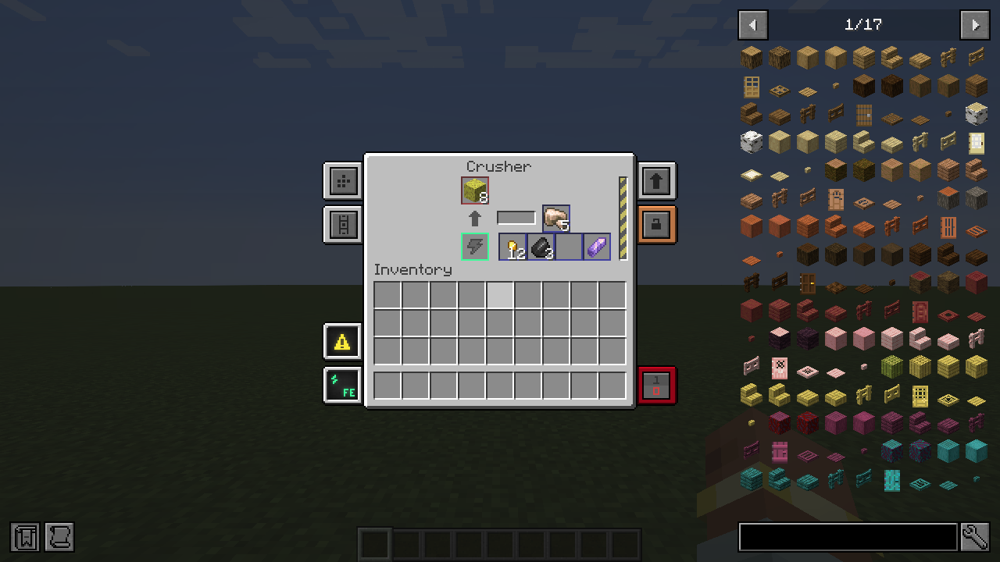
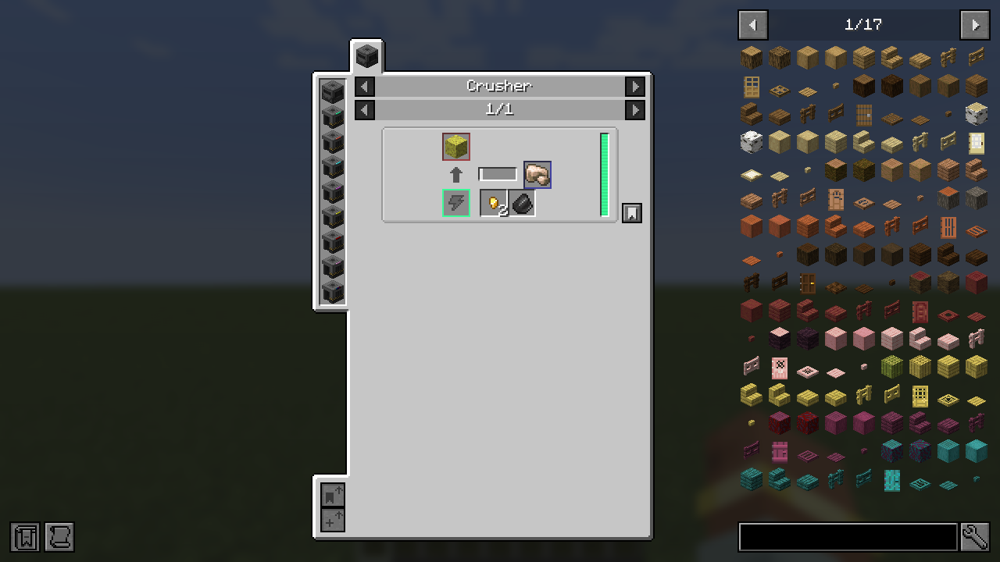
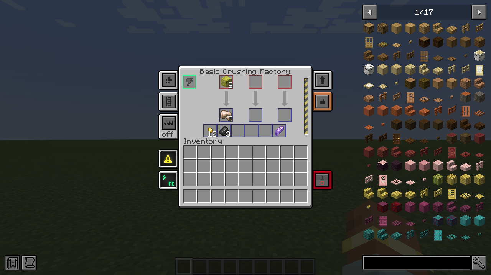
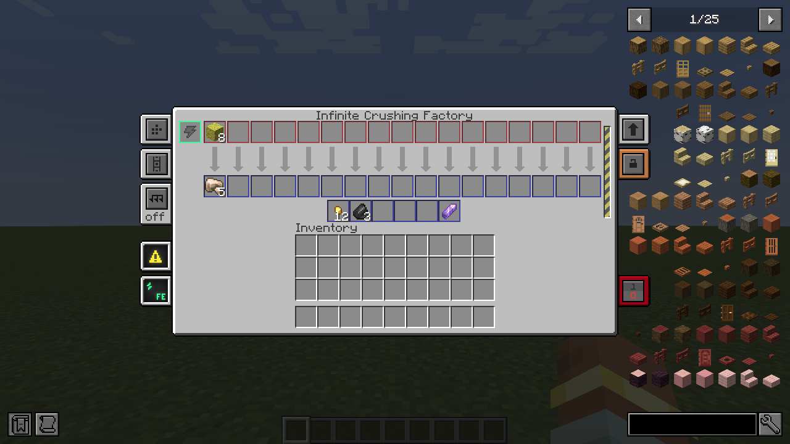

# Mekanism Byproducts

A NeoForge add-on for **Mekanism 10.7 (Minecraft 1.21.1)** that gives the **Crusher and every crushing factory chance-based byproducts**: one main output plus up to 4 extra outputs, each with its own chance.

It doesn't add a new machine. The existing `mekanism:crusher`, the Basic → Ultimate crushing factories, and (when installed) **Mekanism Extras'** Absolute → Infinite crushing factories gain byproduct slots in place. Placed machines, crafting recipes, tier upgrades and JEI keep working.

Example: raw galena → crushed lead, plus 12% silver and 10% fluorite.

| Crusher | JEI |
|---|---|
|  |  |

| Basic crushing factory | Extras Infinite crushing factory |
|---|---|
|  |  |

## Requirements

- Minecraft 1.21.1, NeoForge 21.1.194+
- Mekanism 10.7.19+ (below 10.8)
- Optional: Mekanism Extras 1.4.1+, JEI 19.x

**Install it on both the server and every client.** It changes block entities, menus and recipe syncing.

## Writing recipes

Byproduct recipes use the type `mekbyproducts:crushing`. Their fields are the same as `mekanism:crushing`, plus an optional `byproducts` list (at most 4 entries, `chance` greater than 0 and at most 1):

```json
{
  "type": "mekbyproducts:crushing",
  "input":  { "count": 1, "item": "create_geology:galena" },
  "output": { "count": 1, "id": "create:crushed_raw_lead" },
  "byproducts": [
    { "chance": 0.12, "output": { "count": 1, "id": "mekanism:dust_silver" } },
    { "chance": 0.10, "output": { "count": 1, "id": "create_geology:fluorite" } }
  ]
}
```

KubeJS:

```js
ServerEvents.recipes(event => {
  event.remove({ id: 'mekanism:crushing/some_old_recipe' }) // replace an existing one if needed
  event.custom({
    type: 'mekbyproducts:crushing',
    input: { count: 1, item: 'create_geology:galena' },
    output: { count: 1, id: 'create:crushed_raw_lead' },
    byproducts: [
      { chance: 0.12, output: { count: 1, id: 'mekanism:dust_silver' } },
      { chance: 0.10, output: { count: 1, id: 'create_geology:fluorite' } }
    ]
  }).id('mypack:crushing/galena')
})
```

These are ordinary Mekanism crushing recipes, so every crusher, factory and JEI page picks them up. Plain `mekanism:crushing` recipes keep working with no byproducts.

## How it behaves

- **Rolls:** each byproduct is rolled independently on every operation, including batched operations from speed upgrades.
- **Full slots:** if the byproduct slots can't take every possible byproduct, the machine pauses, just as it does when the main output is full.
- **Pipes and ejection:** byproduct slots count as outputs in side configuration, so pipes can pull from them and auto-eject pushes them out.
- **Factories:** all processes share the one byproduct row.
- **Tier upgrades:** Crusher → factory → … → Infinite carries the byproduct contents over.
- **Older saves:** new slots are added after the original ones, so machines placed before the add-on was installed keep their contents.

## How it works

- **Recipes:** `ByproductCrushingRecipe` extends Mekanism's `BasicCrushingRecipe`. It stays in the `mekanism:crushing` recipe type and has its own serializer.
- **Machines:** small mixins swap the block-entity constructors that Mekanism (and Extras) register for the Crusher and crushing factories. The swaps point to subclasses that add byproduct slots and a multi-output cached recipe.
- **Screens:** client mixins add the extra GUI row to the factory screens.
- **JEI:** a JEI mixin adds byproduct slots to the crushing page.
- **Missing optional mods:** Extras and JEI mixins are skipped automatically when those mods aren't installed.

## Building

Mekanism Extras has no public Maven, so download `mekanism_extras-1.21.1-1.4.1.jar` ([CurseForge](https://www.curseforge.com/minecraft/mc-mods/mekanism-extras) / [GitHub](https://github.com/lostmyself8/Mekanism-Extras)) and put it in `libs/`. It's only needed to compile, not to run.

```bash
./gradlew build                                 # jar in build/libs, runs the unit tests
./gradlew runGameTestServer -PwithExtras        # in-world tests: crusher, factories, upgrades, Extras tier
./gradlew runClientShots -PwithExtras           # dev-only: opens each GUI + the JEI page and saves screenshots
```

Requires Java 21.

## Known limitations

- JEI shows each byproduct's chance only in its tooltip, not as a number on the page.
- Almost Unified probably won't unify byproduct outputs. Use the preferred item ids directly.
- Each Mekanism / Extras update can move the mixin targets. Rebuild and run the GameTests before updating a pack.

## License

MIT
